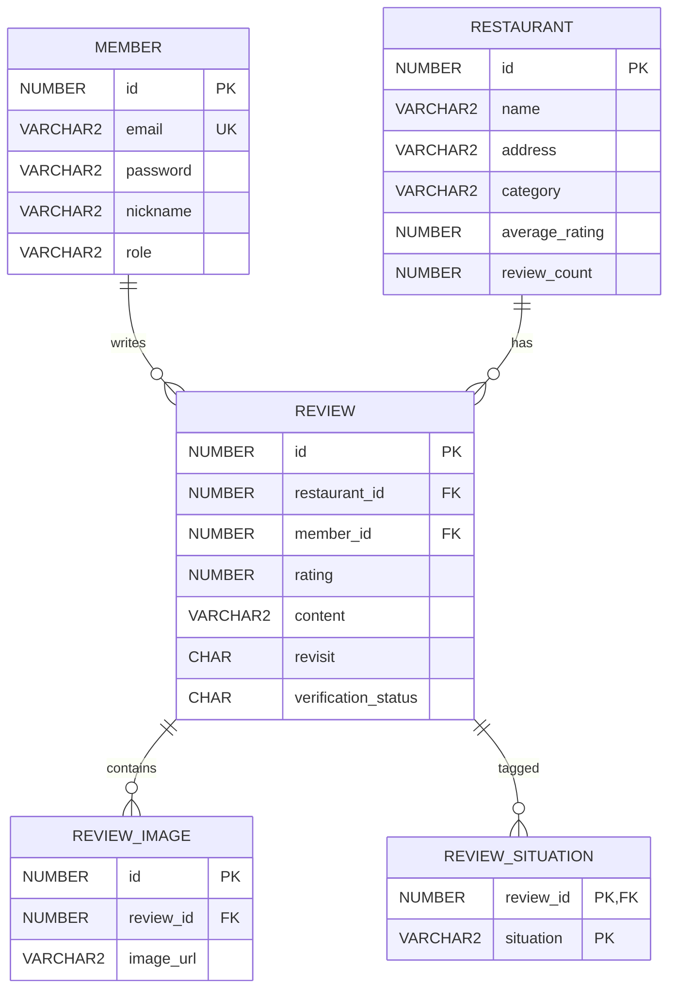

# 🍽️ 천안맛ZIP Backend

> **“천안 내 상황에 딱 맞는 진짜 맛집을 찾다”**

천안 맛집과 리뷰 데이터를 관리하고, 사용자용 React 화면과 관리자용 Thymeleaf 화면에 데이터를 제공하는 **백엔드 저장소**입니다.

> 이 저장소는 5인 팀 프로젝트의 포트폴리오용 저장소입니다.  
> 개인 담당 범위는 **리뷰 CRUD 공동 구현, 관리자 맛집 수정·삭제, 기능 테스트, 발표자료 제작**입니다.

---

## 📌 프로젝트 개요

| 항목         | 내용                      |
| ------------ | ------------------------- |
| 프로젝트명   | 천안맛ZIP                 |
| 개발 형태    | 5인 팀 프로젝트           |
| 개발 기간    | 2026.05.08 ~ 2026.05.18   |
| 백엔드       | Spring Boot 3.x           |
| 데이터 접근  | JDBC · JdbcTemplate       |
| 인증 방식    | Spring Security 세션·쿠키 |
| 데이터베이스 | Oracle                    |
| 사용자 화면  | React REST API            |
| 관리자 화면  | Thymeleaf SSR             |

천안맛ZIP은 사용자가 작성한 리뷰의 상황·테마 데이터를 활용하여 방문 목적에 맞는 맛집 선택을 돕는 서비스입니다. 백엔드는 회원, 맛집, 리뷰, 리뷰 이미지 및 상황 태그 데이터를 관리합니다.

---

## 🏗️ 시스템 구조

```text
React 사용자 화면
        │ REST API · Session Cookie
        ▼
Spring Boot
├─ Spring Security
├─ Controller
├─ Service
├─ DAO
└─ JdbcTemplate
        │ JDBC
        ▼
Oracle Database

관리자 브라우저
        │ SSR · Session Cookie
        ▼
Thymeleaf + Spring Boot

외부 서비스
├─ Firebase Storage: 이미지 업로드 및 URL 연계
└─ Kakao Map API: 맛집 위치 정보 제공
```

---

## ✨ 주요 기능

### 🔐 인증 및 권한

- 이메일 기반 회원가입 및 로그인
- BCrypt를 이용한 비밀번호 암호화
- Spring Security 세션·쿠키 인증
- USER와 ADMIN 권한 분리
- 관리자 URL 접근 권한 제어

### 🍜 맛집 관리

- 맛집 목록 조회
- 카테고리별 맛집 목록 필터링
- 맛집 상세 조회
- 맛집 등록·수정·삭제
- 평균 별점과 리뷰 수 갱신

### ⭐ 리뷰 관리

- 리뷰 작성·조회·수정·삭제
- 별점, 내용 및 재방문 의사 저장
- 한 회원당 같은 맛집에 리뷰 1개 제한
- Firebase Storage 이미지 URL을 리뷰 데이터와 연계
- 리뷰 이미지 최대 3장 등록 및 관리
- 상황·테마 복수 저장
- 리뷰 변경 후 맛집 평균 별점과 리뷰 수 재계산

### 🛠️ 관리자 기능

- 공통 회원 로그인을 통한 ADMIN 권한 인증
- Thymeleaf 관리자 페이지 제공
- 맛집 등록·수정·삭제
- 영수증 인증 대기 목록 조회 및 승인·거절 처리
- 관리자 작업 결과를 사용자 API 데이터에 반영

---

## 🙋‍♀️ 담당 업무

### 백엔드 및 관리자 기능 담당

#### 1. 리뷰 CRUD 공동 구현

- 리뷰 등록·조회·수정·삭제 기능 공동 구현
- 리뷰와 작성 회원·대상 맛집 관계 처리
- 리뷰 이미지와 상황 태그 데이터 연동
- 동일 회원의 동일 맛집 중복 리뷰 방지 흐름 확인
- 리뷰 변경 후 맛집 별점과 리뷰 수 반영 확인

#### 2. 관리자 맛집 수정·삭제

- 관리자 맛집 수정 요청 처리
- 수정 데이터가 사용자 조회 API에 반영되도록 연동
- 맛집 삭제 및 관련 데이터 정리 흐름 확인
- Thymeleaf 관리자 화면과 Service 로직 연동

### 프로젝트 내 추가 담당

#### 3. 기능 테스트 및 결과 검증

- 리뷰 CRUD 동작 확인
- 관리자 맛집 수정·삭제 결과 확인
- 로그인 및 권한에 따른 접근 제어 확인
- 관리자 변경 결과와 사용자 API 응답 일치 여부 확인
- 기능별 테스트 결과 정리

#### 4. 발표자료 제작

- 데이터 흐름과 주요 기능 정리
- ERD 및 역할 분담 시각화
- 구현 결과와 테스트 시나리오 정리

---

## 🔌 주요 API 흐름

### 리뷰 작성

```text
POST /api/reviews
    ↓
ReviewController
    ↓
ReviewService
    ├─ DB UNIQUE 제약으로 동일 회원·맛집 중복 리뷰 방지
    ├─ REVIEW 저장
    ├─ REVIEW_IMAGE 저장
    ├─ REVIEW_SITUATION 저장
    └─ 맛집 평균 별점·리뷰 수 갱신
```

### 맛집 목록 및 필터링

```text
GET /api/restaurants?category=한식
```

- 전체 맛집 목록 조회
- 카테고리 조건 필터링
- 최신 등록순 정렬

### 맛집 상세

```text
GET /api/restaurants/{id}
```

응답 데이터에는 맛집명, 주소, 전화번호, 카테고리, 위치,
평균 별점, 리뷰 수, 대표 이미지 및 인기 메뉴가 포함됩니다.

리뷰 목록은 다음 API에서 별도로 조회합니다.

```http
GET /api/reviews?restaurantId={id}
```

### 로그인

```text
POST /api/members/login
    ↓
Spring Security
    ↓
BCrypt 비밀번호 검증
    ↓
Session 생성
    ↓
JSESSIONID 쿠키 반환
```

### 관리자 맛집 관리

```text
GET    /admin/restaurants
POST   /admin/restaurants

GET    /api/restaurants
GET    /api/restaurants/{id}
PUT    /api/restaurants/{id}
DELETE /api/restaurants/{id}
```

---

## 🗂️ ERD



---

## ✅ 주요 데이터 제약

| 대상                             | 제약              | 목적                                 |
| -------------------------------- | ----------------- | ------------------------------------ |
| MEMBER.email                     | UNIQUE            | 이메일 중복 가입 방지                |
| MEMBER.role                      | CHECK             | USER·ADMIN 권한만 허용               |
| REVIEW.restaurant_id + member_id | UNIQUE            | 동일 맛집 중복 리뷰 방지             |
| REVIEW.rating                    | CHECK             | 1~5점만 허용                         |
| REVIEW.revisit                   | CHECK             | Y·N 값만 허용                        |
| REVIEW_SITUATION                 | 복합 PK           | 동일 상황 태그 중복 방지             |
| 하위 테이블 FK                   | ON DELETE CASCADE | 부모 데이터 삭제 시 연관 데이터 정리 |

리뷰 이미지는 별도 테이블로 분리하여 정규화하고, Service 레이어에서 최대 3장으로 제한합니다.

---

## 💡 구현 시 고려사항

### 중복 리뷰 방지

동일한 회원이 같은 맛집에 여러 개의 리뷰를 작성하지 못하도록  
`REVIEW` 테이블의 `restaurant_id`와 `member_id`에 복합 `UNIQUE` 제약을 적용했습니다.

```sql
CONSTRAINT UK_REVIEW_MEMBER_RESTAURANT
    UNIQUE (restaurant_id, member_id)
```

애플리케이션의 사전 검사에만 의존하지 않고 데이터베이스 제약조건을 함께 사용하여, 동시에 여러 요청이 들어오는 상황에서도 중복 리뷰가 저장되지 않도록 했습니다.

### 세션 기반 인증과 권한 관리

Spring Security의 세션·쿠키 인증 방식을 사용하고, 로그인 성공 시 인증 정보를 `SecurityContext`와 HTTP 세션에 저장했습니다.

회원 권한은 `USER`와 `ADMIN`으로 구분했으며, 맛집 등록·수정·삭제 API와 `/admin/**` 경로는 `ADMIN` 권한을 가진 사용자만 접근할 수 있도록 제한했습니다.

---

## 🧪 수동 테스트 항목

- 회원가입 이메일 중복 확인
- 로그인 세션 유지
- 비로그인 사용자의 리뷰 작성 제한
- 리뷰 이미지 URL 저장 및 조회
- 리뷰 작성·수정·삭제
- 관리자 로그인 및 권한 확인
- 관리자 맛집 등록
- 관리자 맛집 수정 내용의 사용자 화면 반영
- 관리자 맛집 삭제 내용의 사용자 화면 반영
- 맛집 카테고리 필터링
- 맛집 상세 API 응답 확인

---

## ▶️ 실행 방법

### 1. Oracle DB 준비

로컬 Oracle DB를 실행하고 프로젝트에서 사용하는 계정을 준비합니다.

기본 설정은 다음과 같습니다.

```properties
spring.datasource.url=jdbc:oracle:thin:@localhost:1521:XE
spring.datasource.username=SCOTT
```

필요한 테이블과 시퀀스를 생성한 뒤 실행해야 합니다.

### 2. 비공개 설정 파일 생성

`src/main/resources/application-secret.properties` 파일을 생성합니다.

```properties
# Oracle DB
spring.datasource.password=YOUR_DB_PASSWORD

# Kakao Map API
kakao.map.key=YOUR_KAKAO_MAP_KEY

# Firebase
firebase.api-key=YOUR_FIREBASE_API_KEY
firebase.auth-domain=YOUR_FIREBASE_AUTH_DOMAIN
firebase.project-id=YOUR_FIREBASE_PROJECT_ID
firebase.storage-bucket=YOUR_FIREBASE_STORAGE_BUCKET
firebase.messaging-sender-id=YOUR_FIREBASE_MESSAGING_SENDER_ID
firebase.app-id=YOUR_FIREBASE_APP_ID
```

실제 비밀번호와 API 키가 포함된 `application-secret.properties` 파일은 GitHub에 업로드하지 않습니다.

`.gitignore`에는 다음 항목이 포함되어 있어야 합니다.

```gitignore
src/main/resources/application-secret.properties
```

### 3. 애플리케이션 실행

Windows PowerShell:

```powershell
.\gradlew.bat bootRun
```

macOS·Linux:

```bash
./gradlew bootRun
```

애플리케이션은 다음 주소에서 실행됩니다.

```text
http://localhost:8111
```

---

## 🔗 관련 저장소

### 개인 포트폴리오 저장소

- Frontend: https://github.com/h-yuna-lab/matzip-frontend
- Backend: 현재 저장소

### 원본 팀 저장소

- Frontend: https://github.com/SangHyunPark1213/human_mini_project2_frontend
- Backend: https://github.com/SangHyunPark1213/human_mini_project2_backend

---

## 📝 안내

이 저장소는 팀 프로젝트 결과물을 포트폴리오 목적으로 정리한 저장소입니다.

프로젝트 전체 기능 중 개인 담당 범위는 **리뷰 CRUD 공동 구현, 관리자 맛집 수정·삭제, 기능 테스트 및 발표자료 제작**입니다.


## 프로젝트 회고

리뷰 CRUD 공동 구현, 관리자 맛집 수정·삭제와 기능 테스트 경험, 개선 방향은 [홍유나의 천안맛ZIP 프로젝트 회고](https://github.com/h-yuna-lab/matzip-frontend#프로젝트-회고)에 정리했습니다.
