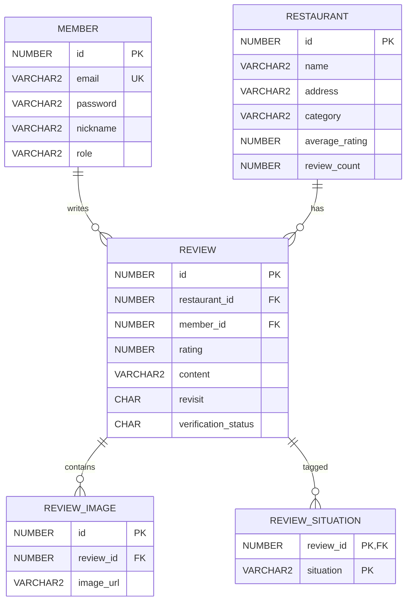

# 천안맛ZIP 백엔드 · 기술 안내

Spring Boot API와 Thymeleaf 관리자 화면의 DB·서버 설정 및 실행 안내입니다. 프로젝트 소개·담당 업무·회고는 [최상위 README](../README.md)에 있습니다.

## 실행 환경과 구성

| 항목 | 구성 |
| --- | --- |
| 서버 | Spring Boot · Gradle |
| 데이터 접근 | JDBC · JdbcTemplate · Oracle |
| 인증 | Spring Security · 세션·쿠키 |
| 사용자 화면 | React REST API |
| 관리자 화면 | Thymeleaf SSR |

Java 버전과 의존성은 [build.gradle](build.gradle)을 확인하세요. SQL 자산은 [sql](sql), HTTP 요청 예시는 [http](http)에 있습니다.

## DB·비공개 설정·실행

### 1. Oracle DB 준비

로컬 Oracle DB를 실행하고 프로젝트에서 사용하는 계정을 준비합니다.

기본 설정은 다음과 같습니다.

```properties
spring.datasource.url=jdbc:oracle:thin:@localhost:1521:XE
spring.datasource.username=SCOTT
```

필요한 테이블과 시퀀스를 생성한 뒤 실행해야 합니다.

### 2. 비공개 설정 파일 생성

`src/main/resources/application-secret.properties` 파일을 생성합니다.

```properties
# Oracle DB
spring.datasource.password=YOUR_DB_PASSWORD

# Kakao Map API
kakao.map.key=YOUR_KAKAO_MAP_KEY

# Firebase
firebase.api-key=YOUR_FIREBASE_API_KEY
firebase.auth-domain=YOUR_FIREBASE_AUTH_DOMAIN
firebase.project-id=YOUR_FIREBASE_PROJECT_ID
firebase.storage-bucket=YOUR_FIREBASE_STORAGE_BUCKET
firebase.messaging-sender-id=YOUR_FIREBASE_MESSAGING_SENDER_ID
firebase.app-id=YOUR_FIREBASE_APP_ID
```

실제 비밀번호와 API 키가 포함된 `application-secret.properties` 파일은 GitHub에 업로드하지 않습니다.

`.gitignore`에는 다음 항목이 포함되어 있어야 합니다.

```gitignore
src/main/resources/application-secret.properties
```

### 3. 애플리케이션 실행

Windows PowerShell:

```powershell
.\gradlew.bat bootRun
```

macOS·Linux:

```bash
./gradlew bootRun
```

애플리케이션은 다음 주소에서 실행됩니다.

```text
http://localhost:8111
```

## 빌드

`backend` 폴더에서 실행합니다.

```powershell
.\gradlew.bat build
```

macOS/Linux에서는 `./gradlew build`를 사용합니다. 빌드 과정의 테스트 실행 조건에 따라 Oracle DB 등 설정이 필요할 수 있습니다.

## 주요 API 흐름

### 리뷰 작성

1. `POST /api/reviews` 요청을 ReviewController와 ReviewService에서 처리합니다.
2. DB UNIQUE 제약으로 동일 회원·맛집의 중복 리뷰를 방지합니다.
3. REVIEW·REVIEW_IMAGE·REVIEW_SITUATION을 저장합니다.
4. 맛집 평균 별점과 리뷰 수를 갱신합니다.

### 맛집 목록 및 필터링

```text
GET /api/restaurants?category=한식
```

- 전체 맛집 목록 조회
- 카테고리 조건 필터링
- 최신 등록순 정렬

### 맛집 상세

```text
GET /api/restaurants/{id}
```

응답 데이터에는 맛집명, 주소, 전화번호, 카테고리, 위치,
평균 별점, 리뷰 수, 대표 이미지 및 인기 메뉴가 포함됩니다.

리뷰 목록은 다음 API에서 별도로 조회합니다.

```http
GET /api/reviews?restaurantId={id}
```

### 로그인

1. `POST /api/members/login` 요청을 Spring Security에서 처리합니다.
2. BCrypt로 비밀번호를 검증합니다.
3. 세션을 생성하고 JSESSIONID 쿠키를 반환합니다.

### 관리자 맛집 관리

```text
GET    /admin/restaurants
POST   /admin/restaurants

GET    /api/restaurants
GET    /api/restaurants/{id}
PUT    /api/restaurants/{id}
DELETE /api/restaurants/{id}
```

## ERD



## 데이터 제약

| 대상                             | 제약              | 목적                                 |
| -------------------------------- | ----------------- | ------------------------------------ |
| MEMBER.email                     | UNIQUE            | 이메일 중복 가입 방지                |
| MEMBER.role                      | CHECK             | USER·ADMIN 권한만 허용               |
| REVIEW.restaurant_id + member_id | UNIQUE            | 동일 맛집 중복 리뷰 방지             |
| REVIEW.rating                    | CHECK             | 1~5점만 허용                         |
| REVIEW.revisit                   | CHECK             | Y·N 값만 허용                        |
| REVIEW_SITUATION                 | 복합 PK           | 동일 상황 태그 중복 방지             |
| 하위 테이블 FK                   | ON DELETE CASCADE | 부모 데이터 삭제 시 연관 데이터 정리 |

리뷰 이미지는 별도 테이블로 분리하여 정규화하고, Service 레이어에서 최대 3장으로 제한합니다.

## 중복·권한 처리

### 중복 리뷰 방지

동일한 회원이 같은 맛집에 여러 개의 리뷰를 작성하지 못하도록  
`REVIEW` 테이블의 `restaurant_id`와 `member_id`에 복합 `UNIQUE` 제약을 적용했습니다.

```sql
CONSTRAINT UK_REVIEW_MEMBER_RESTAURANT
    UNIQUE (restaurant_id, member_id)
```

애플리케이션의 사전 검사에만 의존하지 않고 데이터베이스 제약조건을 함께 사용하여, 동시에 여러 요청이 들어오는 상황에서도 중복 리뷰가 저장되지 않도록 했습니다.

### 세션 기반 인증과 권한 관리

Spring Security의 세션·쿠키 인증 방식을 사용하고, 로그인 성공 시 인증 정보를 `SecurityContext`와 HTTP 세션에 저장했습니다.

회원 권한은 `USER`와 `ADMIN`으로 구분했으며, 맛집 등록·수정·삭제 API와 `/admin/**` 경로는 `ADMIN` 권한을 가진 사용자만 접근할 수 있도록 제한했습니다.

## 기능 확인 항목

- 회원가입 이메일 중복 확인
- 로그인 세션 유지
- 비로그인 사용자의 리뷰 작성 제한
- 리뷰 이미지 URL 저장 및 조회
- 리뷰 작성·수정·삭제
- 관리자 로그인 및 권한 확인
- 관리자 맛집 등록
- 관리자 맛집 수정 내용의 사용자 화면 반영
- 관리자 맛집 삭제 내용의 사용자 화면 반영
- 맛집 카테고리 필터링
- 맛집 상세 API 응답 확인

이번 문서 정리에서 위 항목을 새로 실행한 것은 아닙니다.

## 문서

- [프로젝트 포트폴리오·담당 업무·회고](../README.md)
- [프론트 실행·설정](../frontend/README.md)
- [통합 출처](../SOURCE.md)
