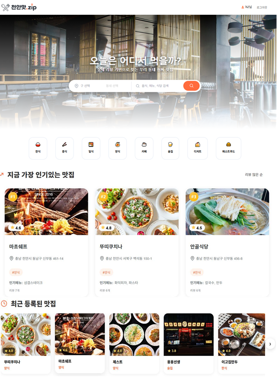
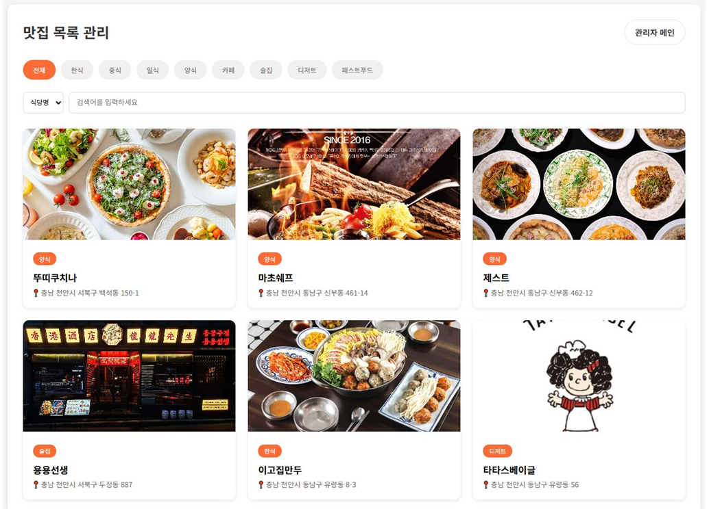
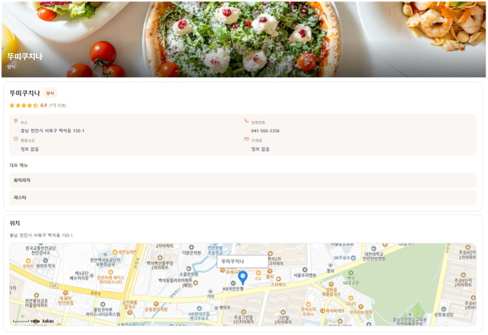
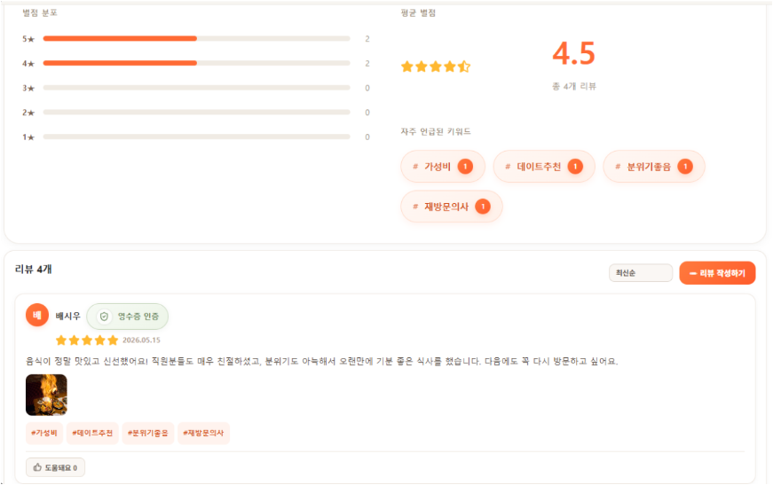
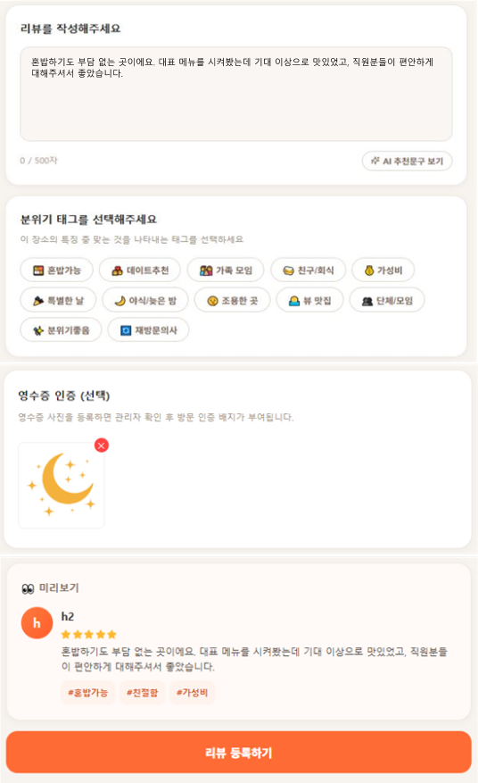

# 🍽️ 천안맛ZIP Frontend

> **“천안 내 상황에 딱 맞는 진짜 맛집을 찾다”**

리뷰 데이터를 기반으로 방문 목적과 상황에 맞는 천안 맛집을 찾을 수 있도록 만든 웹 서비스의 **프론트엔드 저장소**입니다.

> 이 저장소는 5인 팀 프로젝트의 포트폴리오용 저장소입니다.  
> 개인 담당 범위는 **리뷰 CRUD 공동 구현, 관리자 맛집 수정·삭제, 기능 테스트, 발표자료 제작**입니다.

---

## 📌 프로젝트 개요

| 항목         | 내용                                  |
| ------------ | ------------------------------------- |
| 프로젝트명   | 천안맛ZIP                             |
| 개발 형태    | 5인 팀 프로젝트                       |
| 개발 기간    | 2026.05.08 ~ 2026.05.18               |
| 사용자 화면  | React                                 |
| 관리자 화면  | Thymeleaf                             |
| 인증 방식    | Spring Security 세션·쿠키             |
| 데이터베이스 | Oracle                                |
| 핵심 기능    | 상황·테마 기반 맛집 탐색 및 리뷰 관리 |

천안맛ZIP은 단순한 맛집 목록 조회를 넘어, 사용자가 리뷰에 **방문 상황과 테마를 복수 선택**할 수 있도록 구성한 서비스입니다. 축적된 태그는 맛집 상세 화면에서 추천 상황으로 시각화되어, 사용자가 자신의 방문 목적에 맞는 식당을 선택할 수 있도록 돕습니다.

---

## ✨ 핵심 기능

### 🔍 맛집 검색 및 필터링

- 음식 카테고리별 맛집 조회
- 상황·테마 태그를 이용한 맛집 필터링
- 맛집 목록과 상세 정보 조회
- 최신 맛집 및 카테고리별 결과 렌더링

### 🍜 맛집 상세 정보

- 식당명, 주소, 전화번호, 카테고리, 인기 메뉴 표시
- 평균 별점과 누적 리뷰 수 표시
- Kakao Map을 활용한 위치 정보 제공
- 리뷰에서 많이 선택된 상황·테마 태그 시각화

### ⭐ 리뷰 관리

- 로그인 사용자 리뷰 작성
- 작성한 리뷰 수정 및 삭제
- 별점과 재방문 의사 입력
- 상황·테마 복수 선택
- 음식 및 영수증 이미지 업로드
- 한 회원이 같은 맛집에 리뷰를 중복 작성하지 않도록 제한

### 🔐 회원 기능

- 회원가입 및 로그인
- 세션·쿠키 기반 로그인 상태 유지
- 로그인 상태에 따른 리뷰 작성 권한 제어
- 사용자와 관리자 권한에 따른 화면 분기

### 🛠️ 관리자 화면

- 관리자 로그인
- 맛집 등록
- 맛집 목록 및 상세 조회
- 맛집 정보 수정 및 삭제
- 사용자 화면과 변경 데이터 연동

---

## 🙋‍♀️ 담당 업무

### 프론트엔드 담당

#### 1. 리뷰 CRUD 공동 구현

- 리뷰 작성·조회·수정·삭제 화면 구현
- 리뷰 별점, 내용 및 재방문 의사 입력 UI 구성
- 상황·테마 복수 선택 UI 구현
- 리뷰 및 영수증 이미지 업로드 연동
- 리뷰 등록·수정·삭제 API 연동
- 비로그인 사용자의 리뷰 작성 접근 제한 처리
- 작업 완료 후 리뷰 목록이 갱신되도록 상태 처리

### 프로젝트 내 추가 담당

#### 2. 관리자 맛집 수정·삭제

- Thymeleaf 관리자 맛집 수정·삭제 기능 구현
- 수정한 정보가 사용자 맛집 상세 화면에 반영되도록 연동
- 맛집 삭제 후 사용자 화면에서도 제거되는지 확인

#### 3. 기능 테스트 및 결과 검증

- 리뷰 작성·수정·삭제 동작 확인
- 관리자 맛집 수정·삭제 결과 확인
- 사용자 화면과 관리자 화면의 데이터 일치 여부 확인
- 기능별 테스트 결과 정리

#### 4. 발표자료 제작

- 프로젝트 기획 배경 및 핵심 기능 정리
- 역할 분담과 화면 흐름 구성
- 구현 결과와 테스트 내용 시각화

---

## 🧩 리뷰 작성 흐름

```text
맛집 상세 페이지
    ↓
리뷰 작성 선택
    ↓
별점·내용·재방문 의사 입력
    ↓
상황·테마 복수 선택
    ↓
Firebase Storage 이미지 업로드
    ↓
반환된 이미지 URL과 리뷰 데이터 구성
    ↓
Backend Review API 요청
    ↓
등록 완료 후 리뷰 목록 갱신
```

Axios 요청에는 세션 쿠키가 포함되도록 설정하여 로그인 상태를 유지합니다.

```javascript
const api = axios.create({
  baseURL: import.meta.env.VITE_API_BASE_URL,
  withCredentials: true,
});
```

---

## 🏷️ 상황·테마

리뷰 작성 시 여러 상황을 함께 선택할 수 있습니다.

| 상황         | 상황        | 상황        |
| ------------ | ----------- | ----------- |
| 혼밥         | 데이트      | 가족 모임   |
| 친구·회식    | 가성비      | 특별한 날   |
| 야식·늦은 밤 | 조용한 곳   | 뷰 맛집     |
| 단체·모임    | 분위기 좋음 | 재방문 의사 |

맛집 상세 화면에서는 리뷰에서 많이 선택된 태그를 집계하여 **추천 상황**으로 보여 줍니다.

---

## 🛠️ 기술 스택

### 프로젝트 전체 구성

- 사용자 화면: React, Vite
- 관리자 화면: Thymeleaf
- 인증: Spring Security 세션·쿠키
- 데이터베이스: Oracle

### 프론트엔드

- React
- Vite
- JavaScript
- Axios
- CSS
- Firebase Storage
- Kakao Map API

### 협업

- Git
- GitHub
- Notion

---

## 🖥️ 주요 화면

### 1. 메인 화면



천안 맛집을 확인하고 카테고리 및 검색 기능을 이용할 수 있는 메인 화면입니다.

### 2. 맛집 목록



등록된 맛집을 목록으로 조회하고 원하는 맛집을 선택할 수 있습니다.

### 3. 맛집 상세



맛집의 기본 정보, 평균 별점, 리뷰와 추천 상황 태그를 확인할 수 있습니다.

### 4. 리뷰 목록



사용자가 작성한 리뷰의 별점, 내용, 이미지와 방문 상황 태그를 확인할 수 있습니다.

### 5. 리뷰 작성



별점, 리뷰 내용, 재방문 의사와 상황·테마를 선택하여 리뷰를 등록할 수 있습니다.

---

## ▶️ 실행 방법

프로젝트 최상위에 `.env` 파일을 생성합니다.

```env
VITE_API_BASE_URL=http://localhost:8111
```

패키지를 설치하고 개발 서버를 실행합니다.

```bash
npm install
npm run dev
```

백엔드 서버가 실행된 상태에서 프론트엔드 서버를 실행해야 합니다.

---

## 🔗 관련 저장소

### 개인 포트폴리오 저장소

- Frontend: 현재 저장소
- Backend: [Backend](../backend/README.md)

### 원본 팀 저장소

- Frontend: https://github.com/SangHyunPark1213/human_mini_project2_frontend
- Backend: https://github.com/SangHyunPark1213/human_mini_project2_backend

---

## 📝 안내

이 저장소는 팀 프로젝트 결과물을 포트폴리오 목적으로 정리한 저장소입니다.

프로젝트 전체 기능 중 개인 담당 범위는 **리뷰 CRUD 공동 구현, 관리자 맛집 수정·삭제, 기능 테스트 및 발표자료 제작**입니다.


## 프로젝트 회고

리뷰 CRUD를 공동 구현하고 관리자 맛집 수정·삭제, 기능 테스트와 발표자료 제작을 담당했습니다. 리뷰 한 건의 변경이 목록뿐 아니라 맛집의 평균 별점과 리뷰 수에도 영향을 주기 때문에, 화면에서 요청이 성공하는 것과 관련 데이터가 올바르게 반영되는 것을 함께 확인해야 한다는 점을 배웠습니다. 관리자 화면에서 변경한 정보가 사용자 화면에도 반영되는지 확인하며 기능 사이의 연결을 이해했습니다.

다음 프로젝트에서는 리뷰 등록·수정·삭제와 권한별 접근, 관리자 변경 결과의 사용자 화면 반영을 공통 테스트 시나리오로 정리하고 반복 확인을 자동화하고 싶습니다. 공동 구현한 기능은 요청·응답 형식과 담당 범위를 먼저 맞추고, 변경 사항을 문서에 함께 남겨 팀원이 이어서 확인하기 쉽게 개선하겠습니다.
